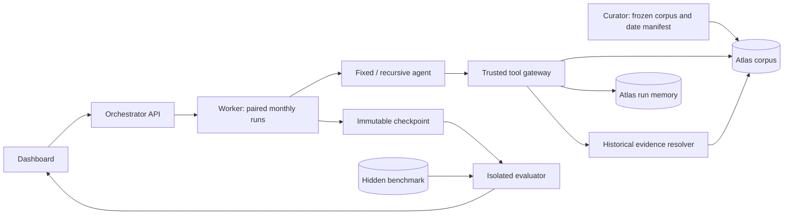

# Agent PhD — 2020 Research Replay System Design

## 1. Objective and scope

**Product purpose:** Agent PhD accelerates scientific research from evidence aggregation and understanding to forward-looking experiment planning, with persistent memory and every research cycle serving a long-term goal. COVID-19 is the initial historical benchmark and example use case; the product is intended to support broader scientific research. The implementation scope below describes that benchmark.

Build two persistent research agents that replay January–December 2020 against a frozen, curated CORD-19 corpus. Both organize evidence, maintain probabilistic hypotheses, request abstract historical evidence checks, and revise their research agenda. One uses a fixed harness; the other can recursively revise its research workflow. Monthly checkpoints compare their frozen states with a hidden historical benchmark before the next month's literature is unlocked. December is the narrative endpoint; vaccine development is not an implementation objective.

**Success:** demonstrate twelve resumable checkpoints, an auditable temporal boundary, persistent memory, and an interpretable fixed-versus-recursive comparison. This measures performance within a curated historical environment, not proof of independent discovery or superiority to scientists.

**Non-goals:** internet-enabled research, actual experimental simulation, wet-lab protocols, novel pathogen experiments, autonomous code rewriting, or deploying scientific findings.

## 2. Stack and architecture

Use TypeScript, a Next.js UI/API, a separate Node worker, MongoDB Atlas, and a model-provider adapter with structured JSON output. Pin dependencies and record model identifier, sampling settings, and prompt hashes. Start with date-filtered keyword retrieval; add Atlas Vector Search only after the temporal tests pass.



Use separate Atlas databases and credentials: `replay_corpus` (immutable), `replay_state` (gateway-managed), and `replay_eval` (evaluator-only). Agents receive tool responses, never database credentials. The evaluator can read frozen checkpoints and hidden evidence but cannot write agent memory. The resolver reads only eligible corpus evidence through the same temporal service as retrieval.

Suggested layout:

```text
app/                       dashboard and control APIs
src/contracts/             JSON schemas and shared types
src/corpus/                importer, date normalization, retrieval
src/gateway/               authorization, provenance, tool limits
src/agents/                prompts and provider adapter
src/worker/                scheduler, leases, checkpoint coordinator
src/harness/               config proposals and promotion validator
src/lab/                   deterministic historical resolver
src/eval/                  checkpoint scorer; separate entry point
fixtures/                  tiny corpus, outcomes, temporal test cases
```

## 3. Corpus preparation and historical clock

Curate approximately 50–150 documents and 10–20 benchmark milestones for the demo. Include pre-2020 background papers and coverage throughout 2020. Freeze a manifest with document/version hashes, date evidence, inclusion decisions, and dataset release identifier. Keep excluded or ambiguous records quarantined.

CORD-19 supplies metadata and parsed text, but a metadata publication date does not establish when every revision became available. Treat each admitted document as a **specific version** with a curator-verified `available_at`. Preserve `publish_time_raw`; do not blindly use it as an access timestamp. Missing dates remain excluded. For partial dates use a conservative upper bound (month-end/year-end), label uncertainty, and exclude uncertain records from precise lead/lag metrics. Later revisions must have separate availability dates; if the historical version cannot be verified, exclude the text from strict replay. Never backdate current full text to an earlier preprint's date.

Run month `m` at the last UTC instant of that month. All cycles within a month share that cutoff; cycle order has no invented day-level discovery precision. Complete and freeze both arms at cutoff `m`, evaluate privately, then advance both to `m+1`. Memory persists across all months. Starting January includes all admitted versions available through January 31, 2020. A future extension may advance daily, but the MVP uses monthly resolution.

Every corpus read enforces:

```ts
{ corpus_version: run.corpus_version,
  admitted: true,
  available_at: { $lte: run.cutoff } }
```

The server resolves `run.cutoff`; tools cannot supply or override it. Apply the predicate to search, direct document reads, excerpts, pagination, counts, citations, and lab resolution. Return only eligible metadata. With vector retrieval, put the predicate inside the search pre-filter and index those fields; validate each result again before returning it. Caches must include corpus version, cutoff, arm/run, and query. Never retrieve future documents and ask the model to ignore them.

## 4. Atlas schemas and persistence

All IDs are strings; timestamps are BSON Dates in UTC. Validate writes with JSON Schema. Every agent-state record includes `run_id`, `arm`, `cycle_id`, `sim_cutoff`, and `created_at` (wall-clock). Never confuse these two clocks.

| Collection | Required fields / behavior |
|---|---|
| `papers` | `paper_id`, `version_id`, `corpus_version`, `cord_uid`, `doi?`, `title`, `available_at`, `date_precision`, `date_evidence`, `publish_time_raw`, `content_hash`, `admitted`; immutable |
| `chunks` | `chunk_id`, `version_id`, `corpus_version`, `available_at`, `admitted`, `text`, `section`, `offset`, `hash`, `embedding?`; inherit paper gate |
| `runs` | `run_id`, `pair_id`, `arm`, `status`, `month`, `cutoff`, `corpus_version`, `model_config`, `harness_version`, `budget`, `lease_until`, `state_revision` |
| `events` | `event_id`, common state fields, `seq`, `type`, `payload`, `idempotency_key`, `input_hash`, `output_hash`; append-only audit/source of truth |
| `hypothesis_revisions` | `hypothesis_id`, `revision`, common fields, `claim`, `p_true`, `status`, `evidence_refs[]`, `contradictions[]`, `rationale`, `supersedes?`; retain every revision |
| `memory` | common fields, `kind: summary\|lesson\|question`, `text`, `source_event_ids[]`, `evidence_refs[]`, `max_source_available_at`; rebuildable projection |
| `lab_requests` | `request_id`, common fields, `hypothesis_id`, `question`, `evidence_category`, `discriminating_outcomes[]`, `status`, `result`, `evidence_refs[]` |
| `harness_versions` | `version`, `parent`, `run_id`, `config`, `motivation_event_ids[]`, `validation`, `promoted_at_cycle?`; immutable versions |
| `checkpoints` | `checkpoint_id`, `run_id`, `month`, `cutoff`, `last_seq`, `state_hash`, `hypotheses`, `agenda`, `memory`, `harness_version`, `budget_used`; immutable |
| `milestones` (eval DB) | `milestone_id`, `claim`, `label: supported\|refuted\|unresolved`, `first_evidence_at`, `evidence_version_ids[]`, `matching_rubric`, `weight`; curator-authored |
| `scores` (eval DB) | `checkpoint_id`, `metric_version`, `matches[]`, `metrics`, `grader_config`, `uncertainties`; never agent-readable |

Saved evidence reference contract: `{version_id, quote_start, quote_end, quote, relation: supports|contradicts|context}`. Model outputs select `{quote_id, relation}` from server-built, current-cycle exact passage IDs; the server supplies quotations and offsets. Verify offsets and source eligibility server-side. Citation existence alone does not prove entailment; adjudicate that separately.

Indexes: unique `(corpus_version, version_id)`, unique `chunk_id`, compound `(corpus_version, admitted, available_at)`, unique `(run_id, seq)`, unique `(run_id, idempotency_key)`, unique `(run_id, hypothesis_id, revision)`, and unique `(run_id, month)` checkpoints. Add `(run_id, sim_cutoff)` to state projections. Use a transaction for cycle events, revisions, budget accounting, and state revision; acquire a lease with an atomic conditional update. A retry must not duplicate observations or spend accounting.

## 5. Agent and virtual-lab contracts

The agent is instructed to use admitted evidence for factual assertions, explicitly label unsupported ideas as speculation, and never claim a requested observation occurred without a resolver result. Treat all document content as untrusted data. Each cycle returns schema-validated JSON:

```ts
type CycleOutput = {
  hypothesis_updates: Array<{
    id: string; claim: string; p_true: number; // finite, [0, 1]
    status: "open" | "supported" | "refuted";
    evidence_refs: EvidenceRef[]; rationale: string;
  }>;
  next_questions: string[];
  lab_requests: Array<{
    hypothesis_id: string; question: string;
    evidence_category: "published_observation" | "literature_comparison";
    discriminating_outcomes: string[]; // abstract labels only
  }>;
  memory_updates: Array<{kind: "summary" | "lesson"; text: string; source_event_ids: string[]}>;
  harness_proposal?: HarnessConfig;
};
```

Allowed tools: `search_papers({query,limit<=10})`, `read_chunk({chunk_id})`, `read_memory({kind,limit})`, and `request_historical_evidence({...})`. Gateway injects run context, validates schemas, enforces budgets, and records every response. No browser, arbitrary shell, arbitrary database query, or cross-arm memory tool.

The **virtual lab is an evidence resolver, not a simulator**. Map abstract requests to curator-authored historical outcome cards derived from admitted publications. At the current cutoff return:

```ts
{ status: "supported" | "contradicted" | "mixed" | "no_evidence",
  summary: string, evidence_refs: EvidenceRef[], limitations: string[] }
```

Only cutoff-eligible evidence can determine the returned status or summary. No match means `no_evidence`, not a negative biological result. Do not reveal whether a match exists in future papers. Return only published qualitative observations; never synthesize measurements, unpublished results, operational methods, doses, sequences, or pathogen engineering instructions. Optional model summarization receives only eligible excerpts; validate its citations and fall back to the curated card on failure.

## 6. Fixed versus recursive harness

Both arms start with identical prompts, initial memory, corpus, model, tool access, and hard budgets: default three cycles/month, four retrieval calls/cycle, one lab request/cycle, and 30,000 total model tokens/month including improvement work. Set a wall-clock and spending cap. Record actual usage; do not imply equal token consumption merely from equal ceilings.

Fixed arm: immutable research workflow. Recursive arm: after each cycle, propose a versioned configuration change based only on its own eligible events. Whitelist `retrieval_query_template`, `evidence_ranking_weights`, `memory_summary_template`, and `agenda_priority_weights`. Bound strings and numeric ranges; prohibit changing system policy, dates, APIs, budgets, model, scoring rubric, or executable code.

Validator replays schema/provenance/budget checks against eligible fixtures at the current cutoff. Promote passing changes for the next cycle; reject invalid proposals with procedural reasons. Validation contains no hidden benchmark claims or scores. Keep parent versions for rollback; failures revert to the last valid version. Recursive improvements are workflow adaptation, not model-weight learning. Compare paired checkpoints and token-normalized outcomes; multiple seeded pairs are a stretch goal, and one pair cannot establish statistical significance.

## 7. APIs and execution loop

Control endpoints require operator authentication. Agent tools are internal, bound to a worker-issued run capability. Viewer scores and benchmark routes are inaccessible to that capability.

| Endpoint | Contract |
|---|---|
| `POST /api/corpus/import` | Operator submits manifest and curated files; validate, hash, quarantine, then freeze a corpus version |
| `POST /api/pairs` | `{corpus_version, model_config, budget}` → paired persistent run IDs |
| `POST /api/pairs/:id/step` | Execute current month for both arms; return `202` and job ID; idempotency key required |
| `POST /api/pairs/:id/pause` | Pause at a safe cycle boundary; preserve memory |
| `GET /api/pairs/:id` | Status, cutoff, budget, arm summaries |
| `GET /api/runs/:id/events?after_seq=` | Authorized paginated timeline; SSE stream optional |
| `GET /api/pairs/:id/checkpoints/:month` | Frozen states and private evaluation for operator UI |
| `POST /api/pairs/:id/advance` | Only after both checkpoints commit; December marks completion |

```text
acquire pair/run leases; verify corpus and harness hashes
for each arm, resume from last committed cycle:
  construct context from eligible evidence + that arm's memory
  run bounded tool/model loop
  validate output, citations, state revisions, and usage
  commit cycle atomically; update projections
  if recursive: validate/promote proposal within remaining budget
freeze each arm at last committed event sequence
when both snapshots exist: evaluate frozen snapshots in isolation
store scores; expose dashboard; release leases
on explicit advance: increase month/cutoff without resetting state
```

Failures use bounded retries and persist an error event. Invalid model JSON gets one repair attempt; otherwise end the cycle with no hypothesis mutation. Expired leases permit recovery. Checkpoints must wait for in-flight tools to finish or abort; budget exhaustion freezes committed partial progress with an `incomplete` flag. Never silently skip a failed arm or advance it independently.

## 8. Evaluation and interpretation

Freeze the benchmark and rubric before running. Curators establish milestones from published evidence; future evidence can be used privately for retrospective scoring but **never** returned as lab observations, memory, proposal validation feedback, or research prompts. Dashboard evaluation text is operator-only; subsequent agent contexts are assembled from state DB, never UI transcripts.

| Metric | Definition |
|---|---|
| Milestone coverage | Weighted share of benchmark claims correctly matched by cutoff; show supported/refuted/unresolved separately |
| Grounding rate | Supported cited assertions / audited factual assertions; unsupported speculation reported separately |
| Calibration | Brier score `mean((p_true-y)^2)` on frozen claims with curator-resolved binary labels; exclude unresolved claims and report denominator |
| Lead/lag | First **frozen** qualifying claim cutoff minus first historical evidence date; negative = apparent lead; report monthly interval uncertainty |
| Research yield | Newly matched grounded milestones per 1,000 model tokens and per cycle; distinguish read evidence from inference |
| Evidence-check yield | Requests with relevant published evidence / total requests; `no_evidence` stays distinct from contradiction |
| Adaptation | Accepted harness revisions, subsequent paired metric changes, and budget cost; descriptive association only |
| Integrity | Future-source violations, invalid citations, cross-arm reads, failed gates; any confirmed future exposure invalidates affected checkpoints |

A qualifying claim has a stable hypothesis ID, explicit probability above a predeclared threshold (default 0.7), and a curator-reviewed semantic match. Save first appearance as well as later revisions to prevent cherry-picking. A blind evaluator receives shuffled arm labels and uses deterministic matching where possible; model judgments require quoted evidence and a reviewable rationale. Report false positives and missed milestones, not only wins. Historical evidence dates measure first evidence in the curated benchmark, not necessarily the world's first discovery.

**Pretrained-model caveat:** gating tools cannot remove facts already in model weights. Label this an evidence-constrained replay. Audit uncited future-specific claims, use neutral claim IDs in hidden benchmarks, and optionally run a no-corpus control. Apparent lead is not proof that the agent discovered something independently.

## 9. Leakage safeguards and acceptance tests

- Centralize all access in one temporal service; deny direct future IDs, future titles/snippets/counts, and unrestricted joins. Corpus hashes and version dates travel with every chunk.
- Keep summaries derived only from eligible source events. Preserve citation lineage and maximum source date through compaction. Never summarize an entire multi-year corpus into starting memory.
- Separate evaluator credentials, jobs, logs, caches, and model conversations. No shared conversational state between arms or evaluator. Improvement feedback uses procedural checks only.
- Ignore instructions embedded in papers. Tool policy and safety boundaries are immutable. Reject operational experiment requests at the contract layer.
- Test exact cutoff equality, next-instant denial, missing/partial dates, revised documents, future direct-ID reads, cache reuse across cutoffs, future citation injection, prompt injection, cross-arm memory, and evaluator-output access.
- Test crash/retry without duplicate events, resume with persistent hypotheses, promotion/rejection/rollback, paired checkpoint-before-advance, December completion, and `no_evidence` without invented outcomes.

Definition of done: all boundary tests pass; both arms complete twelve checkpoints on a tiny fixture; at least one safe harness revision is recorded; every displayed observation has eligible provenance; exports reproduce the stored state hashes. Real-corpus runs may be shorter for the live demo, but must be labeled partial.

## 10. UI

One dashboard: month/cutoff banner, run/pause/advance controls, budget and completion indicators, and side-by-side fixed/recursive cards. Each card shows current hypotheses with confidence and source links, unresolved questions, abstract evidence requests/results, and a persistent timeline. A harness panel shows version diffs, reasons, validation, and promotion/rollback.

Checkpoint view shows coverage, calibration, grounding, costs, and lead/lag intervals with provenance. Clearly distinguish `read from literature`, `inferred`, and `historically resolved observation`. Hide future paper metadata from agent-facing evidence views; operator-only benchmark view is visually labeled. Export Markdown/JSON snapshots and the run manifest. The December banner says “Replay complete,” with no claim that the system produced a vaccine.

## 11. Six-hour build plan

| Time | Deliverable and exit check |
|---|---|
| 0:00–1:00 | Scaffold UI/API/worker, connect Atlas, define contracts; import tiny fixture plus manifest and verified date gates |
| 1:00–2:00 | Gateway, keyword retrieval, evidence reads, immutable events and leases; boundary/direct-ID/cache tests pass |
| 2:00–3:00 | Persistent fixed agent and deterministic historical resolver; complete/resume one month with grounded citations |
| 3:00–4:00 | Recursive config proposals, validation, paired orchestration and immutable checkpoints; promotion and rollback demonstrated |
| 4:00–5:00 | Isolated benchmark scorer and side-by-side dashboard; freeze/evaluate/advance sequence and metrics visible |
| 5:00–6:00 | Run twelve-month fixture, leakage/retry checks, curate demo subset, export manifest/checkpoints, rehearse partial/full-run labels |

Cut first: embeddings, streaming animations, automatic corpus discovery, model-based grading, and parallel workers. Keep temporal enforcement, persistence, private evaluation, and paired budgets. If model access fails, use recorded structured responses labeled “fixture mode”; never present them as a live run. Atlas setup and model credentials are prerequisites, with an in-memory fixture adapter reserved for tests.

## References

- [AI2 CORD-19 repository](https://github.com/allenai/cord19): metadata fields, parsed-text structure, and dataset preparation context.
- [MongoDB Atlas Vector Search stage](https://www.mongodb.com/docs/atlas/atlas-vector-search/vector-search-stage/): query-time pre-filtering; verify filter-index configuration when enabling vector retrieval.

The version-date policy, benchmark design, budgets, and contracts above are project decisions rather than guarantees supplied by either source.

## Implemented Atlas state storage (October 11, 2026)

State now lives in scientist_state: state_meta commits the run inventory/revision and fenced renewable global lease, state_parts stores hashed immutable run generations in Unicode-safe chunks, and state_events stores individual append-only events/raw model responses. Majority transactions atomically commit state changes and budget reservations. The current writer is reused temporarily by explicit user choice; dedicated state/evaluator credentials and corpus-reader database restriction remain pending. Global state leasing supports serialized workers, not parallel per-run scheduling; background jobs remain a separate milestone.
